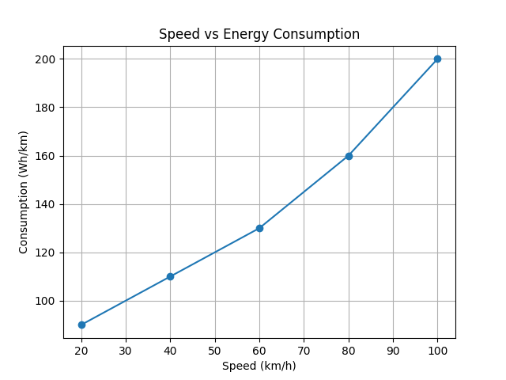
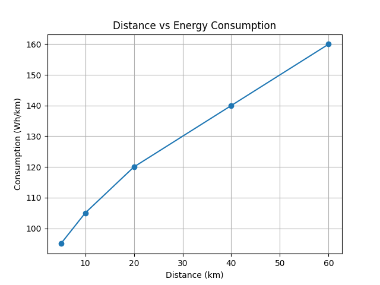

# ⚡ EV Range Estimation & Energy Consumption Analyzer

A Python-based tool that estimates the driving range of an electric vehicle
and analyzes its energy consumption from [driving/vehicle] data, with
visualizations and an interactive interface.

## 📌 Problem Statement
Range anxiety is a major barrier to EV adoption. Range depends on battery
capacity, speed, load, terrain and driving style, so a fixed number is
misleading. This project [estimates range from X inputs and shows where
the energy goes].

## ✨ Features
- Range estimation from [battery capacity, speed, consumption rate, etc.]
- Energy consumption analysis ([per km / per trip / by speed])
- Data visualizations of [consumption vs speed, range comparison, etc.]
- [Interactive interface to enter vehicle parameters and see results]
- Results exported to `range_results.csv`

## 🛠️ Tech Stack
Python · Pandas · NumPy · Matplotlib · [Streamlit / Flask / Tkinter]

## 📂 Project Structure
EV-Range-Estimation-Energy-Consumption-Analyzer/
│
├── data/
│   └── ev_data.csv              # Input dataset (vehicle / driving data)
│
├── modules/
│   ├── range_calculation.py     # Range estimation logic
│   ├── energy_analysis.py       # Energy consumption analysis
│   └── Visualiz.py              # Charts and visualizations
│
├── interface/
│   └── interface.py             # User interface
│
├── app.py                       # Main entry point
├── range_results.csv            # Generated output
└── README.md

## ⚙️ How It Works
1. Load vehicle/driving data from `ev_data.csv`
2. Calculate range using: `Range = Usable Battery Energy (kWh) / Consumption (kWh/km)`
   [adjust to your actual formula and any correction factors]
3. Analyze energy consumption against [speed / load / etc.]
4. Visualize the results and save them to `range_results.csv`

## 🚀 Getting Started
git clone https://github.com/Yashu219/EV-Range-Estimation-Energy-Consumption-Analyzer.git
cd EV-Range-Estimation-Energy-Consumption-Analyzer
pip install -r requirements.txt
python app.py        # or: streamlit run app.py

## 📊 Results
- [Key finding 1, e.g. "Consumption rises sharply above X km/h"]
- [Key finding 2, e.g. "Estimated range for Vehicle A: ~X km"]

## 🔮 Future Improvements
- Add real-time data from a vehicle/OBD or battery sensor
- Include temperature, terrain and regenerative braking effects
- Add an ML model to predict range more accurately
- Deploy as a web app

## 👩‍💻 Author
**Yashaswini A** · yashaswinia21@gmail.com · [LinkedIn] · [GitHub]
